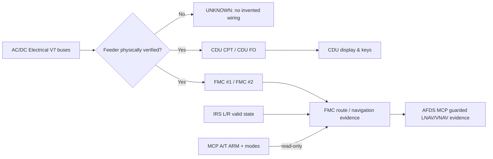

# گزارش مهندسی CDU / FMC بر اساس Chapter 11 — ۳۰ اکتبر ۲۰۲۶

**محدوده:** Boeing 737 Classic 300/400/500، موتور CFM56-3B-1، تنظیمات EP-FSI در Unified. کد حاضر **فقط Procedure/QRH Trainer** است و نرم‌افزار واقعی یا تأییدشدهٔ هوانوردی محسوب نمی‌شود.

## منشأ و میزان پوشش

- نسخهٔ مرجع: Sepehran B737CL FCOM Vol.2 D6-27370-300/400/500-SHI، Chapter 11.
- کل فصل: **۴۰۹ صفحهٔ PDF، شماره‌های 1414 تا 1822**؛ قبلاً ساختار تمام صفحات فهرست‌گذاری شده بود، اما این به معنی تأیید تک‌تک دیاگرام‌ها و رفتارها نیست.
- **۴۵ عنوان نامزد CDU/FMC** در فهرست فصل؛ **۳۷ صفحه/حالت آموزشی قابل نمایش در CDU v6** پس از افزودن POS SHIFT. برخی ۳۷ صفحه هنوز دارای placeholder و مقادیر صرفاً تمرینی‌اند.
- استخراج ساختاری مستقلِ کلیدها، فیلدها، LSKها، promptها و لینک‌ها: `engine/ch11/cdu-page-audit.v1.json`. صفحات دارای تأیید چشمی کامل برای همهٔ نصب‌های 300/400/500: **هنوز صفر**.
- تصویر اسکن‌شده یا متن کامل اختصاصی سازنده عمداً داخل مخزن عمومی بازنشر نشده؛ متن/تصاویر اصل باید در Technical Database خصوصی بمانند.
- `IDENT` منبع FCOM 11.40.8 / PDF1560؛ `POS INIT` 11.40.11 / PDF1563؛ `POS REF` 11.40.13–11.40.17 / PDF1565–1569؛ `POS SHIFT` 11.42.47 / PDF1721؛ `PERF INIT` 11.40.37 / PDF1589؛ مدار الکتریکی FMC و Recovery در 11.32.5–6 / PDF1546–1547.

## تغییرات فعال Unified

- **فقط همان دو CDU موجود** با صفحه و Scratchpad جدا و دادهٔ FMC مشترک؛ ابعاد تصویر 1199×1312 و نقشهٔ دقیق ۷۰ کنترل **دست‌نخورده**.
- نمایش متن سبز `#40eb79` با `BoeingCDULarge` و `BoeingCDUSmall` موجود؛ تغییر فقط در `cdu-embed.css` است و قفل فونت شکسته نشده.
- چرخش `POS INIT 1/3 → POS REF 2/3 → POS SHIFT 3/3` با NEXT/PREV، شامل چرخش معکوس. `OP PROGRAM` در IDENT به موقعیت L4 و `SUPP DATA` به R5 اصلاح شده‌اند.
- ردیف‌های `POS REF`: FMC POS، IRS L، IRS R، GPS L، GPS R، RADIO؛ مقادیر IRS L/R از State واقعی IRS Trainer نمایش داده می‌شوند. دادهٔ تأییدنشدهٔ GPS/RADIO/FMC position عمداً خالی است. در موقعیت‌های فعلی برخی برچسب‌های مربوط به اپشن‌های FCOM نیازمند تأیید عکس هستند.
- مدل `engine/ch11/fmc-systems-network-v1.js`: State جداگانهٔ FMC1/FMC2/CDU_CAPT/CDU_FO، تشخیص True/False/Unknown منبع برق با شواهد؛ ارتباط با `IRS`، CDU Route، `MCP/AFDS` و خواندن وضعیت `A/T ARM` و mode بدون فرمان دادن به thrust levers.
- در شرایط قطع **اثبات‌شدهٔ تغذیهٔ CDU**، فقط نمایشگر/چراغ‌ها خاموش و فرمان کلیدها مسدود می‌شود. وجود برق روی باس اصلی به‌تنهایی روشن بودن فیدر CDU را **اثبات نمی‌کند**؛ حالت نامشخص، CDU را در حالت تمرینی نگه می‌دارد.
- `LNAV/VNAV` تنها پس از اثبات هم‌زمان مسیر اکتیو بدون ناپیوستگی، منبع موقعیت معتبر، و شواهد مستقل تغذیهٔ FMC قابل‌صدور به عنوان **evidence** هستند؛ اجرای هدایت، Servo یا دستور A/T از این پل **مجاز نیست**.

## نگاشت برق (منبع → مدار → مصرف‌کننده)

**مبنای فنی:** `engine/cb/all-circuits-audit.v2.json` و `engine/cb/wiring-manifest.v1.json`. این اطلاعات عکس و اندیس تجهیزات‌اند؛ **هیچ مسیر باس→CB→فیدر مشخص EP-FSI تا امروز تأیید نشده است**. تشخیص کاندیدا مساوی با اثبات سیم‌کشی نیست.

| مصرف‌کننده / عبارت عکس CB | موقعیت کاندیدا | سطح اطمینان |
| --- | --- | --- |
| FMCS CMPTR NO.1 | P18-2 E8 | Photo index / Bus unverified |
| CDU NO.1 (Captain) | P18-2 E9 | Photo index / Bus unverified |
| FMCS COMPTR NO.2 | P6-1 C12 | Photo index / Bus unverified |
| CDU NO.2 (FO) | P6-1 C13 | Photo index / Bus unverified |
| FMC AC | P18-2 D1, P6-1 D8 | Photo index; branch/effectivity unknown |
| DAA FMC NO.1 / NO.2 | P18-2 C5 / P6-1 D13 | Photo index; assignment unknown |
| FMCS MODE ANN | P18-2 E7 | Photo index; feeder unknown |
| AFDS MCP DC | P18-1 D1 | Generic MRG equipment index corroborated; airframe bus unknown |
| AFDS MCP CRS 2 | P6-2 B2 | Photo index; feeder unknown |

تا زمان استخراج WDM/SSM/AMM مربوط به نصب EP-FSI و بررسی cross-feed/alternate supply، قطع این CBها **به‌صورت ساختگی** به مصرف‌کنندهٔ هواپیما نسبت داده نمی‌شود.

## رفتار فقدان برق FMC — FCOM 11.32.5–6

- کمتر از ۱۰ ثانیه: داده‌های واردشده باقی می‌مانند، LNAV/VNAV disengage.
- ۱۰ ثانیه یا بیشتر روی زمین: پس از بازگشت تغذیهٔ FMC، پیش‌پرواز باید دوباره انجام شود.
- بیش از ۱۰ ثانیه در پرواز: داده‌ها باقی می‌مانند؛ لازم است active waypoint/leg دوباره انتخاب شود؛ `MOD RTE LEGS` و اعلان بازیابی در مدل State ثبت می‌شوند.
- خطای FMC تابع نصب/Software Update است؛ FAIL/MENU/EHSI behavior قبل از قطعی‌کردن نیازمند تأیید effectivity است.
- اجرای خاموش‌شدن واقعی یا هشدار FMA هنوز فقط در حد **مدل و event** است؛ E2E نهایی مرورگر/تست در پرواز انجام نشده.

## ممیزی و اجرای آزمون

- تست شبکهٔ FMC/CB: `node --test engine/ch11/tests/fmc-systems-network-v1.test.cjs`.
- تست گردش صفحات و عدم جعل GPS: `node --test cdu-standalone-v6/tests/ch11-position-pages-v1.test.cjs`.
- قفل فونت و باینری‌های موجود: `node tests/cdu-font-lock.test.cjs`.
- Workflow مرتبط: `.github/workflows/ch11-fmc-systems-network-v1.yml`.
- **لازم برای پذیرش نهایی:** بازبینی تصویری تمام page variants ریزبه‌ریز، تست مرورگر به همراه CB power failure, تایید مدل موتور/Software Options، مسیر کامل IRS/FMC/AFDS/MCP/A/T، و بررسی ایرادات احتمالی CI. تا آن زمان وضعیت `SOURCE_AUDITED_PARTIAL / NO_AIRCRAFT_WIRING_SIGNOFF` است.
